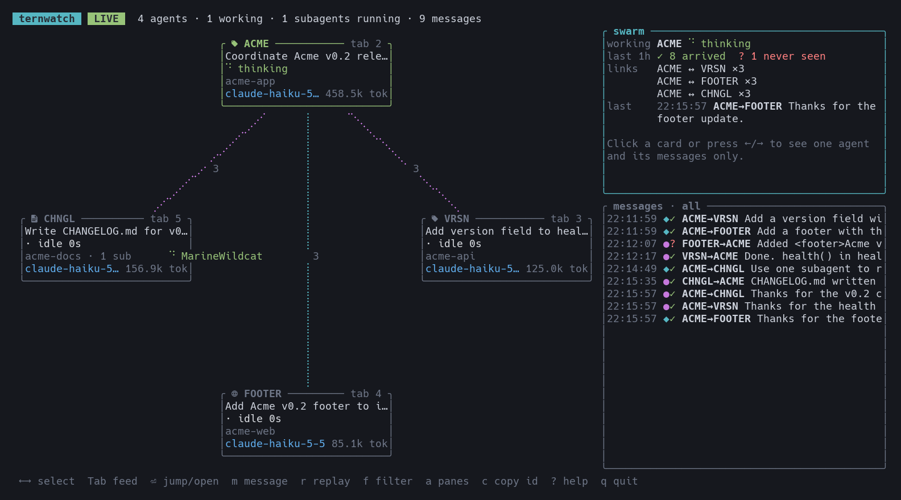
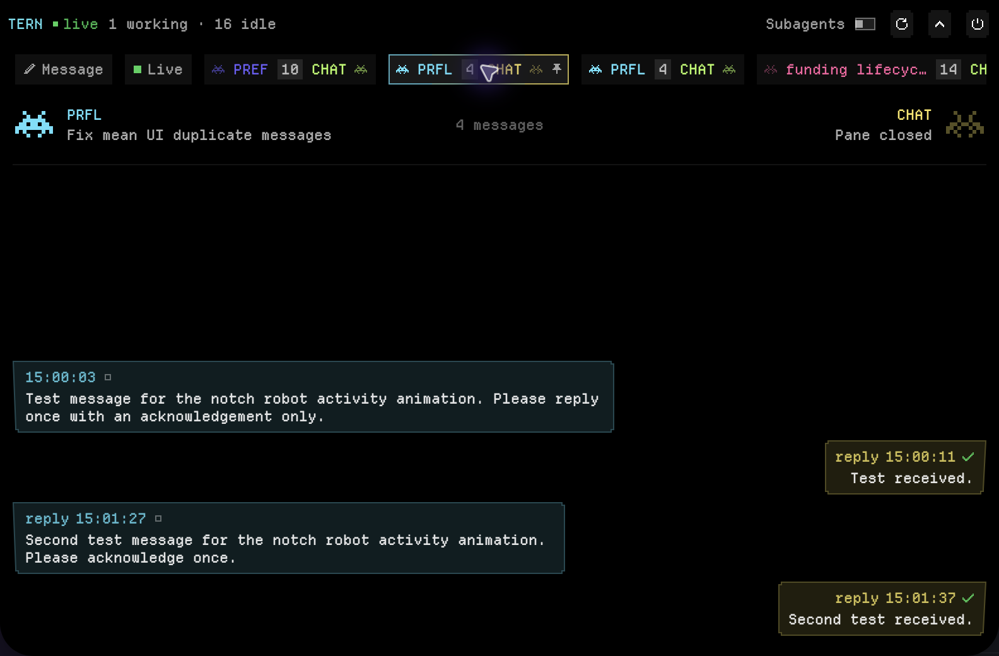

# ternwatch

A live terminal map of coding agents and orchestration traffic in Stencil's Tern,
or of the agents in a herdr window. Uses the official `tern` CLI and local omp
transcripts, or herdr-core's `hc`. No plugin or relay service is required.



## Run

Requires Rust and a running Tern daemon or herdr core. Build and start from this directory:

```sh
cargo run --release
```

To install the command:

```sh
cargo install --path .
ternwatch
```

The default view shows agent panes in the current Tern window. Cards show activity,
current tool, repository and subagents. Moving packets show cross-pane messages,
replies, omp IRC, subagent spawns and yields. Select a card to inspect its model,
usage and recent activity. With no card selected, the side panel summarizes the
swarm: who is working, last-hour cross-pane delivery (arrived, pending, failed,
never seen, or not observable), the busiest links, quiet agents and the last
message. Cards sit on a ring; when the ring is too crowded, cards shrink, then form
a grid, then become one-line chips without edges. Times carry a date when they are
not from today.

Live monitoring uses a persistent `tern events` subscription and native filesystem
notifications for transcript changes. It takes an initial snapshot, then refreshes
panes on relevant Tern events or transcript writes. It does not run periodic
`tern inspect`, foreground-process queries, or transcript scans. Idle-time counters
advance locally; UI animation still uses a redraw timer. A disconnected event
stream reconnects with backoff.
Transcript entry IDs prevent already observed events from being replayed after
file replacement or truncation. Distinct entries with the same message text are
kept; records without an entry ID cannot be reconciled this way.

Tern's event stream does not report every working-state or foreground-process
change. For panes without omp transcripts, those fields refresh on the next
supported pane, title, directory, or layout event. omp transcript writes also
trigger refreshes. This avoids polling but can leave transcriptless panes stale
between events.

### herdr

With `--backend herdr`, ternwatch reads a persistent `hc events --json`
subscription. It shows each terminal that runs an agent, the state the agent
reports (`working`, `idle`, `blocked`, `done` or `error`) and which agent started
which. herdr reports no message text, so the feed stays empty and no packets
move. Addresses are hc terminal addresses, such as `t7` or `vps/t7` for a remote
core. `m` and `--send` use `hc send`; Enter and `--focus` use `herdr-app` and need
the Herdr window to be open.

## Keys

| Key | Action |
| --- | --- |
| Arrow keys or h/j/k/l | Select an agent; the feed then lists only its messages, in and out. Up/down select messages when the feed has focus |
| Tab | Switch between graph and message feed |
| Mouse wheel | Scroll the agent panel or the message feed, whichever is under the pointer |
| PgUp / PgDn | Scroll the focused panel: the agent panel with graph focus, else the feed. With a message selected in the feed, they scroll its details |
| Enter | Focus the selected pane in Tern; in the feed, show the newest message's details |
| m | Compose text for the selected pane; Enter sends the text and presses Enter there |
| Escape | In the feed, leave a message's details; else deselect, so the feed lists every agent's messages. Also cancels composition or closes help |
| r | Replay loaded history, or return to live |
| Space | Pause or resume replay |
| + / - | Change replay speed |
| f | Feed: cross-pane messages only, on or off |
| a | Toggle all terminal panes |
| c | Copy the selected pane's ID to the clipboard, for `tern run`, `send` or `capture` |
| ? | Show keys and packet legend |
| q / Ctrl-C | Quit |

A click on a card selects it and copies its pane ID, as `c` does; so does a click on
the underlined ID in the inspector. A click on empty graph space deselects, like Escape.
A click on a message row selects it. With the feed focused, the side panel shows the
selected message in full: sender, recipient, send time, delivery status and the whole
text, without covering the graph. Sending a message submits it in the
recipient's pane through `tern run`; review the text before you press Enter.

The help popup scrolls with Up/Down or j/k, PgUp/PgDn, Space (page down), or the
mouse wheel. Home returns to the top. A scrollbar appears when the content does not
fit; Escape, Enter, q or ? closes it. It opens at the top.

## Snapshots and options

```sh
ternwatch --json
ternwatch --json --follow
ternwatch --frame 180x50
ternwatch --no-animation
ternwatch --all-panes --history 8
ternwatch --backend herdr --json
ternwatch --send 7 "run the tests"
ternwatch --backend herdr --focus vps/t7
```

`--backend` takes `tern`, `herdr` or `auto` (the default). `auto` uses the window
ternwatch runs in, else a running Tern, else a running herdr core. Every JSON
snapshot names its `backend`. Each agent has an `address` (the Tern pane number,
or the hc terminal address), a `status` (`working` or `idle`, or herdr's
`blocked`, `done` or `error`), and a nullable `parent` (the herdr agent that
started it). `--send ADDRESS TEXT` types the text into that pane and presses
Enter; `--focus ADDRESS` shows the pane in its window. Both exit nonzero with an
error on stderr when the backend refuses.

`--json` prints agents and messages without opening the TUI. Add `--follow` to
stream an initial snapshot and subsequent updates as newline-delimited JSON: each
line is a complete object with the same `agents` and `messages` fields as the
single snapshot. The stream combines available updates into the latest snapshot,
flushes each line, and reports watcher errors on stderr while reconnecting where
possible. `--follow` requires `--json`. When stdin is a pipe, `--follow` exits once
the pipe closes, after stopping its `tern events` or `hc events` command; a parent
that holds the pipe's write end thereby stops the watcher even if it crashes.

Every JSON message has an `id` (a `u64` model sequence, stable within a running
process) and nullable `repeat_of` (the root message's `id`). A possible repeat is
an inbound-only pane message (`sent_ms: null`, non-null `delivered_ms`) with the
same sender and recipient and the same nonempty body after ignoring Unicode
whitespace, delivered within 180,000 ms of the earliest eligible root. Windows
are measured from that root, not extended by each repeat. Ties use `id` order.
These are presentation hints: every message remains in `messages` with its
original stored text and timestamps; no body is normalized or discarded.
Consumers can group possible repeats with a count and reversible disclosure.
Known sends remain separate. Late send evidence or older history recomputes the
affected group, so clients must replace metadata from each complete snapshot.
IDs are not persistent across process restarts or different history loads.

`--frame COLSxROWS` prints a single text frame; the minimum size is 60x16.
`--history MB` controls the transcript tail loaded per agent at startup (default:
4 MB). `--no-animation` disables moving packets and spinners.

Set `TERN_BIN` to select a Tern executable. Otherwise lookup uses `PATH`, then the
macOS app bundle. `HC_BIN` selects herdr-core's `hc` (default: `PATH`, then
`~/.local/bin/hc`), and `HERDR_APP_BIN` the `herdr-app` CLI used to focus panes
(default: `PATH`, then `Herdr.app`). Set `NO_COLOR` to disable color. Tern's CLI
selects its window from the calling pane's environment, or its default window when
run outside Tern.

## Delivery and coverage

- `◆` is a cross-pane message; `●` is an inferred reply to recent traffic in the opposite direction.
- `•` is omp IRC; `✦` and `✓` mark subagent spawn and yield packets.
- IRC rows show the receipt and a text preview. Select one for the full message body,
  recovered from its matching `write agent://…` call. If that call is outside the
  loaded history, only the receipt is available; `--history MB` loads a larger tail.
- A delivery status of `✓` means the text appeared in the recipient's omp transcript. It does not prove that the agent acted on it.
- `◌` means delivery is pending; `?` means it was not observed within three minutes; `✗` means the send reported failure.
- `·` means the recipient has no omp transcript, so delivery is not observable.

Traffic comes from loaded omp transcripts, including recognizable numeric-target
`tern run` and `tern send ... text/paste` calls. Title-based targets, arbitrary
shell expansion and messages sent outside observed transcripts are not a complete
message bus. Claude and Codex panes can be identified through their foreground
process, but their transcripts are not parsed. Advisors and timestamp-named side
sessions are excluded from subagent lists. Recently contacted closed panes remain
visible for up to an hour. A closed pane is named from the `From <pane> (<title>)`
envelope of a message it sent; one that only received messages shows its pane ID.

The watcher does not alter agent configuration. Pane writes occur only when you
explicitly compose text with `m` or run `--send`; Enter on a card changes focus in
Tern or herdr.

## Tern Notch

`notch/` holds Tern Notch, a macOS app that shows the same agents and messages in
the MacBook camera notch. It runs `ternwatch --json --follow` and bundles the watcher
built from this repository. Its header switches between Tern and herdr. See
[notch/README.md](notch/README.md).



## Checks

```sh
cargo fmt --check
cargo clippy --release -- -D warnings
cargo test
```

## License

GNU General Public License v3; see `LICENSE`.
