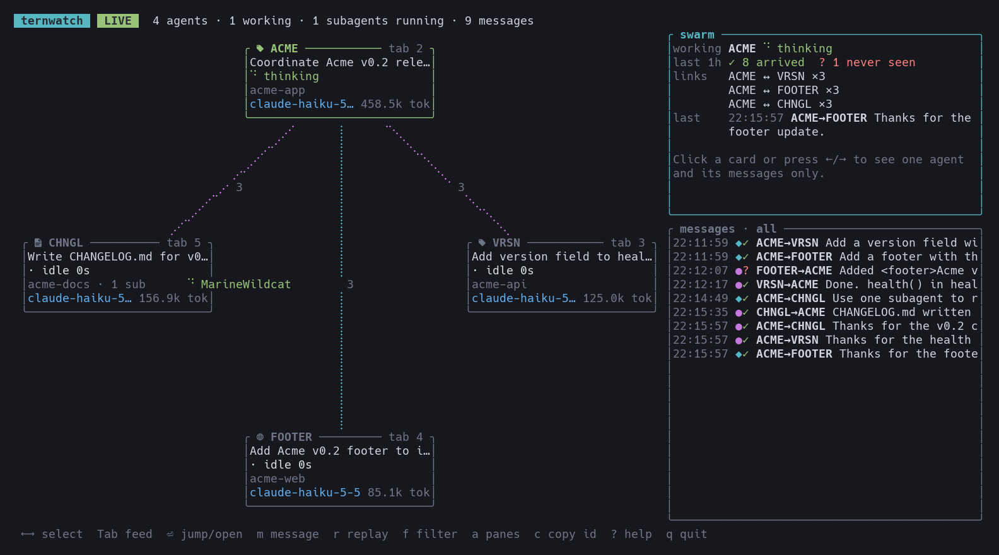

# ternwatch

A live terminal map of coding agents and orchestration traffic in Stencil's Tern.
Uses the official `tern` CLI and local omp transcripts. No Tern plugin or relay service is required.



## Run

Requires Rust and a running Tern daemon. Build and start from this directory:

```sh
cargo run --release
```

To install the command:

```sh
cargo install --path .
ternwatch
```

The default view shows agent panes in the current Tern window. Cards show activity,
current tool, repository and subagents. Moving packets show cross-pane messages,
replies, omp IRC, subagent spawns and yields. Select a card to inspect its model,
usage and recent activity. With no card selected, the side panel summarizes the
swarm: who is working, last-hour cross-pane delivery (arrived, pending, failed,
never seen, or not observable), the busiest links, quiet agents and the last
message. Cards sit on a ring; when the ring is too crowded, cards shrink, then form
a grid, then become one-line chips without edges. Times carry a date when they are
not from today.

## Keys

| Key | Action |
| --- | --- |
| Arrow keys or h/j/k/l | Select an agent; the feed then lists only its messages, in and out. Up/down select messages when the feed has focus |
| Tab | Switch between graph and message feed |
| Mouse wheel | Scroll the agent panel or the message feed, whichever is under the pointer |
| PgUp / PgDn | Scroll the focused panel: the agent panel with graph focus, else the feed. With a message selected in the feed, they scroll its details |
| Enter | Focus the selected pane in Tern; in the feed, show the newest message's details |
| m | Compose text for the selected pane; Enter sends the text and presses Enter there |
| Escape | In the feed, leave a message's details; else deselect, so the feed lists every agent's messages. Also cancels composition or closes help |
| r | Replay loaded history, or return to live |
| Space | Pause or resume replay |
| + / - | Change replay speed |
| f | Feed: cross-pane messages only, on or off |
| a | Toggle all terminal panes |
| c | Copy the selected pane's ID to the clipboard, for `tern run`, `send` or `capture` |
| ? | Show keys and packet legend |
| q / Ctrl-C | Quit |

A click on a card selects it and copies its pane ID, as `c` does; so does a click on
the underlined ID in the inspector. A click on empty graph space deselects, like Escape.
A click on a message row selects it. With the feed focused, the side panel shows the
selected message in full: sender, recipient, send time, delivery status and the whole
text, without covering the graph. Sending a message submits it in the
recipient's pane through `tern run`; review the text before you press Enter.

The help popup scrolls with Up/Down or j/k, PgUp/PgDn, Space (page down), or the
mouse wheel. Home returns to the top. A scrollbar appears when the content does not
fit; Escape, Enter, q or ? closes it. It opens at the top.

## Snapshots and options

```sh
ternwatch --json
ternwatch --frame 180x50
ternwatch --no-animation
ternwatch --all-panes --history 8
```

`--json` prints agents and messages without opening the TUI. `--frame COLSxROWS`
prints a single text frame; the minimum size is 60x16. `--history MB` controls the
transcript tail loaded per agent at startup (default: 4 MB). `--no-animation`
disables moving packets and spinners.

Set `TERN_BIN` to select a Tern executable. Otherwise lookup uses `PATH`, then the
macOS app bundle. Set `NO_COLOR` to disable color. Tern's CLI selects its window
from the calling pane's environment, or its default window when run outside Tern.

## Delivery and coverage

- `◆` is a cross-pane message; `●` is an inferred reply to recent traffic in the opposite direction.
- `•` is omp IRC; `✦` and `✓` mark subagent spawn and yield packets.
- IRC rows show the receipt and a text preview. Select one for the full message body,
  recovered from its matching `write agent://…` call. If that call is outside the
  loaded history, only the receipt is available; `--history MB` loads a larger tail.
- A delivery status of `✓` means the text appeared in the recipient's omp transcript. It does not prove that the agent acted on it.
- `◌` means delivery is pending; `?` means it was not observed within three minutes; `✗` means the send reported failure.
- `·` means the recipient has no omp transcript, so delivery is not observable.

Traffic comes from loaded omp transcripts, including recognizable numeric-target
`tern run` and `tern send ... text/paste` calls. Title-based targets, arbitrary
shell expansion and messages sent outside observed transcripts are not a complete
message bus. Claude and Codex panes can be identified through their foreground
process, but their transcripts are not parsed. Advisors and timestamp-named side
sessions are excluded from subagent lists. Recently contacted closed panes remain
visible for up to an hour. A closed pane is named from the `From <pane> (<title>)`
envelope of a message it sent; one that only received messages shows its pane ID.

The watcher does not alter agent configuration. Pane writes occur only when you
explicitly compose text with `m`; Enter on a card changes focus in Tern.

## Checks

```sh
cargo fmt --check
cargo clippy --release -- -D warnings
cargo test
```
