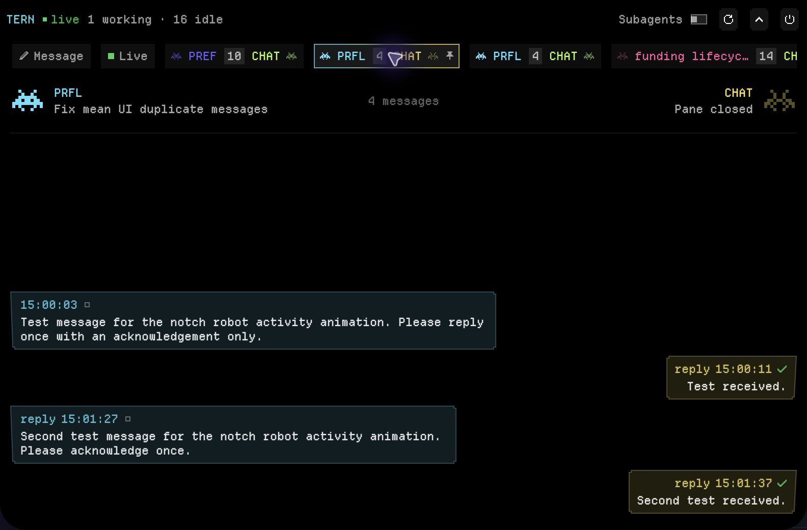

# Tern Notch

Tern Notch is a small macOS app for watching Tern agents talk to each other and directing them. It extends the camera notch with a black surface and has no menu bar icon or Dock icon. Everything inside the notch is pixel art: one art pixel is one point, text uses the bundled Departure Mono pixel font, boxes have stepped corners, icons are pixel sprites, and glows are dithered instead of blurred. The notch outline and its shadow stay smooth, to match the physical camera housing. When collapsed, it adds a narrow wing on each side of the camera, and each wing always holds one agent over a dithered glow in its color. The two agents are those of the conversation shown in the notch, on the same sides as in the open notch. With no conversation yet, they are the first two working agents, then idle ones; a wing with no agent shows a crew avatar, which turns orange while the watcher is offline. No line runs between the wings; the robots themselves show activity. When a new message arrives, the sender hops one pixel and flares its antenna tip, the recipient's eyes widen, and both glows brighten.

Rest the pointer on the notch for a moment to unfold it from the top edge of the screen into a surface about 820 × 520 points, limited to the screen. Opening on hover never activates the app or takes keyboard focus, so typing stays in the app you were using. Move the pointer away and the notch folds back after about half a second. Click inside the open notch to pin it, for example to select text or type in the composer. A pinned notch takes keyboard focus and stays open until you click another app, press Esc enough times, or click the chevron or the header. Clicking the collapsed notch opens it already pinned. If you fold the notch while the pointer is still on it, move the pointer away before hover can open it again. The stream keeps running while the notch is collapsed.

## The open notch

The header beside the camera starts with the window being watched, **TERN** or **HERDR**; click it to watch the other one. The choice is kept between launches; until you choose, the watcher picks Tern when it runs, else herdr. Next come the watcher state and how many agents are working, blocked (herdr only), and idle. On the right are the **Subagents** switch (Tern only), Restart watcher, Collapse, and Quit (the power button). Cmd-Q also quits while the notch has keyboard focus.

Below the header is a strip of recent conversations. It starts with **Message**, which lets you write to any agent (see below), then **Live**. Each conversation is a pair of agents, and each chip shows both agents' faces and names with the message count between them, newest first. A chip glows briefly when a new message arrives in its conversation. **Live** follows the conversation with the latest message. Click another chip to pin that conversation in both the open and collapsed notch. Click **Live** to follow the latest conversation again.

The shown conversation reads as two agents facing each other. The agent who sent the first loaded message is on the left, and the sides never swap as replies arrive. Each side of the header shows the agent's face, name, and what it reports it is doing, with the message count between them. Below the header is the transcript, oldest first, and it scrolls to the newest message as messages arrive. The left agent's messages hug the left edge and the right agent's the right edge, each in that agent's color. Each bubble shows the time and delivery state, and failed messages have a red outline.

When ternwatch marks inbound deliveries as possible repeats, the transcript shows one bubble with a **Possible repeat · 2 copies** disclosure (or the current copy count). Expand it to see every original message separately, then collapse it again at any time. Conversation chips and headers count groups as messages. The transcript shows the newest 150 groups, oldest first; agent details show the newest 80 groups under **Exchanges**, newest first, with the same disclosure. These presentation limits apply after grouping, so every original in a displayed group remains accessible. Counts include all loaded groups. Click any original message to see its existing timestamp and read or copy its unchanged full text. Grouping updates when ternwatch revises the possible-repeat reference; no message content is removed from the loaded data.

The stream accepts optional `id` and `repeat_of` fields (`UInt64` receipt identifiers). Messages from older watchers without these fields remain ungrouped and use the same presentation limits. Receipt IDs keep selections and traffic identity stable when a late send observation updates a message; possible repeats and reclassification do not replay sender reactions.

Faces are one-color 10 × 7 pixel space invaders, matching the reference sprite's paired antennae, hanging arms, inward feet, square eye holes, and wide mouth opening. Each keeps its agent's identity color and the same layout footprint. They show only states the stream reports. In the collapsed wings, a working invader continuously alternates between two poses every 450 ms: it bobs one art pixel and spreads its antenna tips, then returns. This makes working status visible even without new messages. In the open notch, working invaders retain their occasional blink or antenna wiggle. An orchestrator waiting on running subagents spreads its antennae and glances aside. An idle invader has closed eyes, dims, and stays still except for fresh-message reactions; a closed pane shows a dim invader with × eyes. An offline invader is orange. While a new message travels, the sender hops one pixel and flares both antenna tips, and the recipient's eyes widen; these reactions take priority over the collapsed working bob. Reduce Motion disables working animation and message poses.

**Subagents** is off by default and the setting is kept between launches. While it is off, conversations are between top-level panes only, so messages to or from subagents and messages within one pane are left out. If no conversation is left, the notch says how many subagent messages are hidden and points to the switch. While it is on, each subagent takes part in conversations on its own, including with its parent. A subagent always gets a color different from its parent's, and it keeps that color from launch to launch.

Click a face or name in the conversation header to see that agent's details, its exchanges, and a message composer. To message an agent directly, including one with no conversation yet, click **Message** at the start of the conversation strip. A list of every agent replaces the conversation, with each agent's robot, name, and state, working agents first. Choose an agent and its details open with the composer focused. Click **Message** again or press Esc to close the list. The strip and **Message** are available whenever the stream lists agents, even before any conversation exists. Closed panes are listed but cannot be chosen. Click a bubble to read the full message, copy it, or jump to the sender or recipient. Esc and the back button step back one level at a time: from the agent list or a message, to an agent, to the pinned conversation, to the live conversation, and finally fold the notch. Focus opens the selected pane in Tern. Send runs `tern run` with the composed text, which types it into that pane and presses Enter. Nothing is sent until you press Return or the send button. Delivery states report what the transcripts show, not proof that a recipient acted on a message. Your pinned conversation, selection, and draft are kept while the notch is collapsed.

Message reactions and traffic glows run only for messages sent in the last few seconds, and only after the first snapshot. Loaded history, reconnects, and delivery-state updates never trigger them. The collapsed working cycle continues independently while an agent reports working, and stops when it becomes idle or the notch opens. Idle faces have no repeating animation task. Reduce Motion turns off working motion, blinking, traffic glow changes, and face reactions.

herdr reports agents and their state, but no message text. While watching herdr, the conversation strip holds only **Message**, and a **HERDR AGENTS** tree takes the transcript's place: each agent with its CLI, folder, time quiet, and herdr's own state word (`working`, `idle`, `blocked`, `done`, or `error`). Agents started by another agent are indented under it. Click an agent for its details: Focus shows its terminal in the Herdr window, the copy button copies its hc address (such as `vps/t7`), and the composer sends text through `hc send`. Focus needs the Herdr window to be open; a failed action appears as a banner.

## Requirements

- macOS 14 or later, Xcode 15 or later, and Rust (`cargo`) to build.
- Tern and its `tern` command-line executable, or herdr with herdr-core's `hc` (and `herdr-app` to focus terminals).

The app ships its own `ternwatch`. Its build compiles the watcher from the repository root (`cargo build --release --locked`) and copies it into `TernNotch.app/Contents/MacOS/`, so the app always runs the watcher from the same checkout. The build script adds `~/.cargo/bin`, `/opt/homebrew/bin`, and `/usr/local/bin` to `PATH` to find `cargo`. For development, set `TERNWATCH_BIN` to another `ternwatch` executable in the Xcode scheme's Run environment or in the launch environment; it then replaces the bundled one.

The app looks for `tern` on its inherited `PATH`, plus `~/.local/bin`, `~/.cargo/bin`, `/opt/homebrew/bin`, and `/usr/local/bin`. It also checks `/Applications/Tern.app/Contents/MacOS/tern`. Set `TERN_BIN` to override it. The watcher looks for herdr's `hc` and `herdr-app` on that same `PATH`, then in `~/.local/bin/hc` and `/Applications/Herdr.app`; set `HC_BIN` or `HERDR_APP_BIN` to override them. A graphical app does not necessarily inherit your shell's PATH.

## Build and run

Open `notch/TernNotch.xcodeproj` in Xcode, select the `TernNotch` target, and run it. If signing requires configuration, select your development team in the target's Signing & Capabilities settings. The project has no third-party package dependencies. It bundles the Departure Mono font by Helena Zhang (`TernNotch/Resources/DepartureMono-Regular.otf`) under the SIL Open Font License 1.1; the license is in `TernNotch/Resources/DepartureMono-LICENSE.txt`. The app is unsandboxed so it can launch the local Tern tools.

On a notched display, the collapsed surface is exactly as tall as the camera housing and centered on it. On other displays, a matching notch is drawn over the center of the menu bar. Connection errors appear as a banner with Copy and Restart buttons. The header's Restart button restarts `ternwatch`. The app also retries a stopped or missing stream automatically. To quit, open the notch and click the power button, or press Cmd-Q while the notch has keyboard focus.

## Layout

Tern Notch lives in `notch/` of the ternwatch repository. It was previously the separate `LadderChaos/tern-notch` repository, which is now archived.

- `TernNotch/`: the app sources (`TernNotchApp.swift`, `NotchHoverPolicy.swift`, `PixelKit.swift`, `Companion/`), bundled font in `Resources/`, and the app icon in `Assets.xcassets`.
- `TernNotch.xcodeproj`: the Xcode project with the single `TernNotch` target (bundle identifier `local.tern.notch`) and a "Bundle ternwatch" build phase.
- `assets/`, `icon.svg`, `icon-concepts.html`: icon and artwork sources. The `AppIcon` images are rendered from `icon.svg`; the 16, 32 and 64 px images use the heavier strokes shown in `icon-concepts.html`.
- `STATUS.md`: current state. `DECISIONS.md`: architectural decisions. `CHANGELOG.md`: change history.

## Attribution and license

This app began as notchHUD, a fork of [boring.notch](https://github.com/TheBoredTeam/boring.notch) by TheBoredTeam. The current app is a standalone rewrite and no longer contains the boring.notch sources. The repository is licensed under the GNU General Public License v3; see `../LICENSE`.
